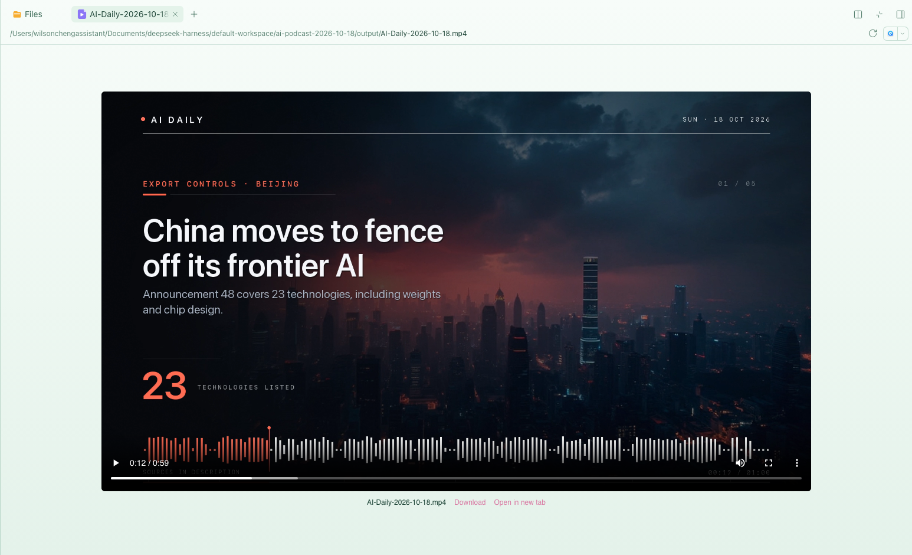
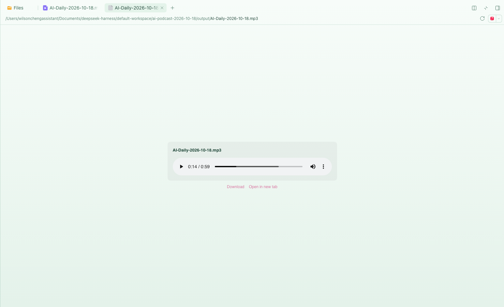

# dsh-media-web-preview

Play **video and audio inside the DSH right Sidebar** — including from a remote
browser, where the native **Open** button would otherwise launch QuickTime or
Music on the Host Mac.

[](https://www.npmjs.com/package/dsh-media-web-preview)
[](LICENSE)

## The problem

DeepSeek Harness's document preview renders text, Markdown, code, images, PDF,
HTML, Office documents and spreadsheets. It has no audio or video renderer, and
`mp4`, `mp3`, `wav`, `flac`, `ogg`, `m4a`, `aac`, `wma` and `opus` are listed as
known binary containers with no viewer. Opening one shows:

> Preview is not available for this file type yet. **Open**

`Open` asks the **Host** to launch the file in a native application. On the
machine running the Host that is fine; from a phone, another laptop, or a
Tailscale peer it opens a window on a screen you are not looking at.

## What this plugin does

It registers two document renderers, `video` and `audio`, and draws the
browser's native player in the preview pane. A companion Host route streams the
file with HTTP `Range`, so seeking works and a large video is never read into
memory or into the conversation.

- **Native controls** — play/pause, seek, volume, fullscreen (video), and the
  browser's own picture-in-picture where available.
- **Seek without downloading everything** — `206 Partial Content` +
  `Content-Range`; the player asks for the bytes it needs.
- **Remote-browser ready** — the URL is document-relative, so the same preview
  works under `http://127.0.0.1:3080`, a LAN address, a Tailscale MagicDNS name,
  or `tailscale serve` on port 80. No configuration.
- **Download / open in a new tab** — both actions sit under the player.
- **Localized** — English and Simplified Chinese dictionaries.
- **Zero runtime dependencies** — one Host module and one browser bundle.





## Formats

| Kind | Suffixes |
| --- | --- |
| Video | `mp4` `m4v` `webm` `ogv` `mov` `mkv` `avi` `mpg` `mpeg` `3gp` `3g2` `ts` `m2ts` |
| Audio | `mp3` `m4a` `m4b` `aac` `wav` `flac` `ogg` `oga` `opus` `weba` `aiff` `aif` `wma` `mid` `midi` |

Playback is the browser's decision: Chromium plays H.264/AAC MP4, WebM, Ogg and
most audio, but usually cannot decode Matroska (`.mkv`) or AVI. When a codec is
unsupported the player shows an explicit message and the download link rather
than failing silently.

## Install

From npm:

```sh
dsh plugin --profile web add dsh-media-web-preview
```

From a local directory:

```sh
dsh plugin --profile web add file:/absolute/path/to/dsh-media-web-preview
```

`dsh plugin add` records the dependency **and** appends the package to
`dsh.profile.bundles`; the package ships `dsh.bundle.patch`, so no manual
`insert:` row is needed in the profile's `cordis.patch.yml`.

The Host half hot-mounts into the running `dsh web`; **refresh the page once**
so the browser bundle enters the module graph. If your build only composes
plugins at boot, restart `dsh web` instead.

Then open any supported file in the Sidebar's **Files** tab. The native **Open**
menu stays available at the top.

## Why a second file route

DSH already has `GET /api/file`, used by the image and Markdown previews. It
always answers with a full `200`, **ignores `Range`**, and caps the response at
the attachment image limit (20 MB by default). That is fine for images and
hopeless for video: no seeking, and a large file just returns `413`.

Rather than change a shared route, this plugin adds a range-capable sibling:

| | `/api/file` | `/api/media` |
| --- | --- | --- |
| Full response | `200` | `200` |
| `Range` request | ignored (full `200`) | `206` + `Content-Range` |
| Seeking | must download the whole file | immediate |
| Byte cap | ~20 MB | bounded by the filesystem |
| Reads | whole file buffered | 1 MiB chunks via `ctx.fs.readByteRange` |

Both routes sit under `/api`, so the Connection service applies the same Host /
Origin check and browser-cookie authentication to both.

## Implementation

```
lib/index.js      Host: GET/HEAD /api/media, Range parsing, chunked streaming
lib/client.js     Browser: documentPreviews + sidebar.right.tab.document
cordis.patch.yml  bundle insert row
```

The browser half registers through `ctx.documentPreviews` with
`loading: 'renderer'` and declares the suffixes as binary so nothing falls back
to a text preview. The player reads the absolute path from the `file` resource
(`useResource(resourceAddress).value.absolutePath`), builds a document-relative
`api/media?path=…` URL, and calls `content.loaded(version)` once to end the
loading state.

The Host half registers `ctx.connection.fetch.register({ path: '/api/media',
methods: ['GET', 'HEAD'] })`. Requests resolve through `ctx.fs`, so the Host's
own file policy still applies; `parseRange` turns `Range` into a closed
interval. `416` carries `bytes */<size>`; `HEAD` returns headers only;
`download=1` adds an attachment `Content-Disposition`.

## Security

- The route lives under `/api`, so it inherits the same authentication and
  Host/Origin checks as every other DSH API. Unauthenticated requests get `401`;
  an untrusted Host gets `403`.
- Only absolute paths are accepted; there is no directory listing, and nothing
  bypasses the filesystem provider's resolution and access policy.
- Responses carry `Cache-Control: private, no-store` and
  `X-Content-Type-Options: nosniff`.
- No telemetry, no outbound network requests, no runtime dependencies.

## Verified

- A 59.6 s MP4 plays and seeks to 40 s over a Tailscale MagicDNS URL.
- A 28.6 MB MP4 returns `413` on `/api/file` but `200` / `206` on `/api/media`.
- `Range: bytes=0-1023` returns `206`, `Content-Length: 1024`,
  `Content-Range: bytes 0-1023/<size>`.
- Unauthenticated requests return `401`; an invalid range returns `416` with
  `bytes */<size>`.
- An MP3 reads its metadata and seeks to 30 s.

## Compatibility

- DSH `0.2.0-rc.2` web composition, and later versions that keep providing
  `ctx.documentPreviews`, `sidebar.right.tab.document`, `ctx.connection.fetch`
  and `ctx.fs.readByteRange`.
- Node 22+.
- Also usable from the DSH desktop app: the in-app route is document-relative.

## Scope

This plugin focuses on the **stock right Sidebar** and **remote-browser
playback**. It does not provide playlists, subtitle tracks, playback-speed
controls, or inline media cards in the chat transcript — other community
plugins cover those. Playback behaviour is whatever the browser's native
controls provide.

## Development

```sh
npm test        # node --test: Range parsing and MIME mapping
```

There is no build step. `lib/client.js` is a hand-written module-loader bundle
(`window.__ModuleLoader__.load`) that requests only `react` and
`react/jsx-runtime`, so it uses the Host's own React.

End-to-end check: with the plugin installed in a DSH web instance, open a
supported file and confirm the `<video>`/`<audio>` element reaches `readyState`
`4` and that `currentTime` follows after a seek.

## License

[MIT](LICENSE) © 2026 Wilson Cheng
